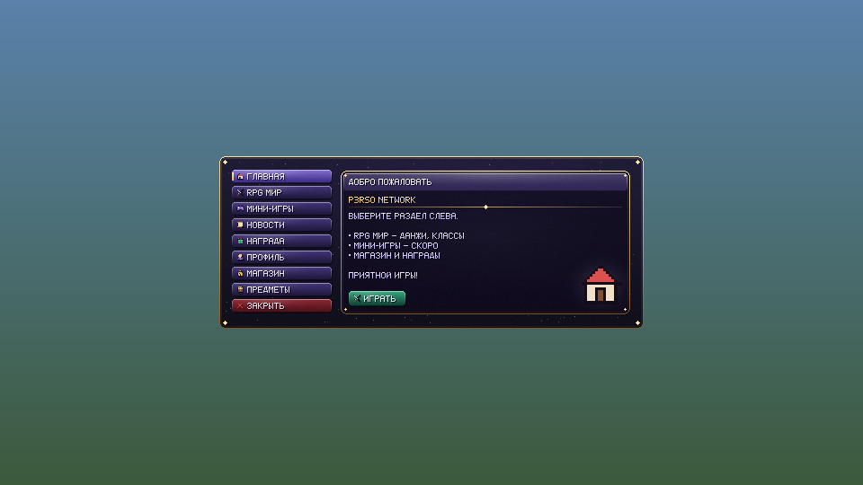
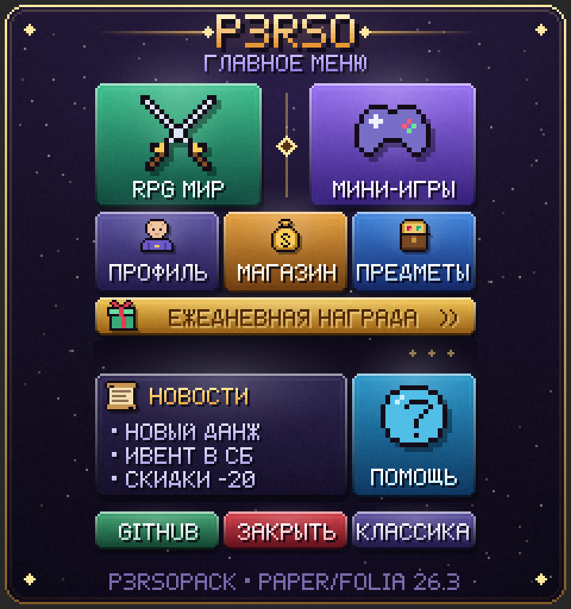
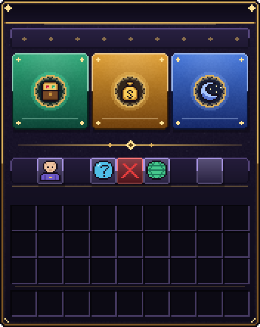
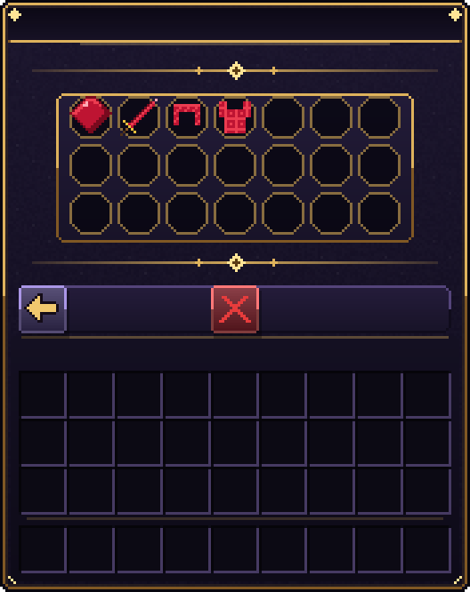
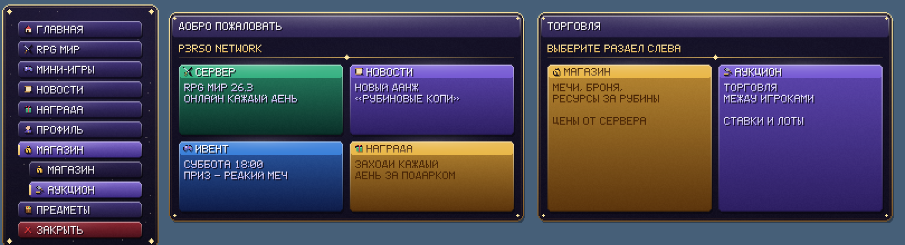

# P3rsoPack

Плагин для **Paper / Folia 26.3**: кастомные предметы, интерфейсы (GUI), блоки и мебель для обычного
ванильного клиента без модов. Ресурспак собирается автоматически из конфигов и папки `pack/`,
раздаётся встроенным HTTP-сервером и отправляется игроку ещё до входа в мир.

- **Предметы**: компонент `item_model` (без устаревшего CustomModelData), имя/лор в MiniMessage, атрибуты,
  зачарования, прочность, броня через `equippable` с автогенерацией equipment-ассета.
- **GUI**: окна из YAML, фон окна — картинка через глиф шрифта и отрицательные сдвиги в заголовке,
  действия на клики (команды, переходы между окнами, выдача предметов, звуки, сообщения).
- **Глифы и HUD**: `<glyph:id>` и `<shift:N>` в любом тексте, постоянный HUD в action bar.
- **Блоки**: до 674 блоков на состояниях нотного блока; свои дропы, опыт, звуки и твёрдость
  (скорость копания честно считается сервером и клиентом через атрибут `block_break_speed`).
- **Мебель**: `item_display` + хитбокс `interaction` или barrier-блоки, повороты, сидения.
- **Ресурспак**: правильный `pack_format` 26.3 (97), детерминированный zip — **одинаковый SHA-1 на всех
  серверах сети** при одинаковых конфигах; режим внешнего URL для сети за Velocity.
- **Понятные ошибки**: `items/ruby.yml:12: неизвестный материал 'DIAMOND_SWORDD' (может быть, 'DIAMOND_SWORD'?)`.
- **Folia**: `folia-supported: true`, только региональные/entity/async-планировщики.

## Установка

1. Нужны Java 25 и сервер **Paper или Folia 26.3**.
2. Положите `P3rsoPack-<версия>.jar` в `plugins/` и запустите сервер — в `plugins/P3rsoPack/` появятся
   примеры (рубин, рубиновый меч и броня, руда, стул, стол, магазин).
3. Для кастомных блоков включите в `config/paper-global.yml` и перезапустите сервер:
   ```yaml
   block-updates:
     disable-noteblock-updates: true
   ```
4. Откройте порт пака (по умолчанию **8164/TCP**) или настройте `pack.hosting` (см. ниже).
5. Зайдите на сервер: `/menu` — меню у края экрана, `/fmenu` — полноэкранное меню-сундук, `/cmenu` — классическое; `/p3rsopack give @s ruby`.

Сборка из исходников:

```bash
./gradlew build
```

Готовый jar — `build/libs/P3rsoPack-<версия>.jar`.

## Структура папки плагина

```
plugins/P3rsoPack/
├── config.yml          — namespace, хостинг и отправка пака, HUD
├── items/*.yml         — предметы
├── guis/*.yml          — окна
├── blocks/*.yml        — блоки (у каждого автоматически есть предмет с тем же id)
├── furniture/*.yml     — мебель (у каждой автоматически есть предмет с тем же id)
├── glyphs/*.yml        — картинки для текста: фоны окон, HUD, иконки
├── pack/               — ваши ресурсы в структуре ресурспака:
│   ├── pack.png
│   └── assets/p3rso/
│       ├── textures/item/…   textures/block/…   textures/gui/…
│       ├── textures/entity/equipment/humanoid/…  (броня на игроке)
│       └── models/…           (свои 3D-модели, например из Blockbench)
├── data/block-variations.yml — какие состояния нотного блока заняты какими блоками (не удалять!)
└── output/pack.zip     — собранный пак (для внешнего хостинга)
```

Файлов в каждой папке может быть сколько угодно, подпапки тоже читаются. Один файл может содержать
несколько определений: каждый раздел верхнего уровня — это id. Id без префикса получает `namespace`
из `config.yml` (`ruby` → `p3rso:ruby`). Допустимы только строчные латинские буквы, цифры и `_ . - /`.

После любых изменений: **`/p3rsopack reload`** — конфиги перечитаются, пак пересоберётся и (если он
изменился) будет разослан игрокам онлайн. Ошибки выводятся в консоль и в чат с указанием файла и строки;
повторно посмотреть их — `/p3rsopack errors`.

## Пример: добавить предмет

1. Нарисуйте текстуру 16×16 и положите её в `pack/assets/p3rso/textures/item/sapphire.png`.
2. Создайте `items/gems.yml`:
   ```yaml
   sapphire:
     material: PAPER
     name: "<blue>Сапфир"
     lore:
       - "Синий камень"
     texture: item/sapphire
   ```
3. `/p3rsopack reload`, затем `/p3rsopack give @s sapphire`.

### Все поля предмета

| Поле | Описание |
|---|---|
| `material` | базовый ванильный предмет (по умолчанию `PAPER`) — определяет поведение |
| `name`, `lore` | MiniMessage; поддерживаются `<glyph:id>`, `<shift:N>` |
| `texture` | текстура (или список текстур-слоёв) → модель сгенерируется с `item/generated` |
| `handheld: true` | держать как инструмент (`item/handheld`) |
| `textures` + `parent` | произвольные слоты текстур и родитель модели |
| `model` | своя модель из `pack/assets/<ns>/models/…` (например `furniture/chair`) |
| `item-model` | готовое определение предмета, напр. `minecraft:sunflower` (ничего не генерируется) |
| `max-stack-size`, `max-damage`, `unbreakable`, `glint`, `hide-tooltip` | компоненты предмета |
| `attributes` | список `{attribute, amount, operation, slot}`; заменяют стандартные атрибуты материала |
| `enchantments` | `{sharpness: 2}` |
| `equippable` | `{slot, asset, equip-sound, camera-overlay, swappable, damage-on-hurt}` |

Свой файл `pack/assets/<ns>/items/<id>.json` (например с `select`/`condition`) имеет приоритет над
сгенерированным. Текстуры не из `textures/item/` и `textures/block/` автоматически добавляются в атлас.

### Броня

```yaml
sapphire_helmet:
  material: LEATHER_HELMET
  texture: item/sapphire_helmet
  equippable:
    slot: head
    asset: sapphire
  attributes:
    - {attribute: armor, amount: 3, slot: head}
```

Текстура брони на игроке: `pack/assets/p3rso/textures/entity/equipment/humanoid/sapphire.png`
(для поножей — `humanoid_leggings/sapphire.png`). Файл `equipment/sapphire.json` создаётся автоматически.

## Пример: окно (GUI)

1. Фон: картинка 176×222 (как окно сундука на 6 рядов) в `pack/assets/p3rso/textures/gui/bank.png`.
2. `glyphs/bank.yml`:
   ```yaml
   bank_bg:
     texture: gui/bank
     height: 222
     ascent: 13   # совмещает верх картинки с верхом окна
   ```
3. `guis/bank.yml`:
   ```yaml
   bank:
     title: "<white>Банк"
     rows: 6
     background: bank_bg
     items:
       deposit:
         slot: 20
         item: sapphire
         name: "<green>Положить"
         left-actions:
           - "command: bank deposit"
           - "sound: entity.experience_orb.pickup"
         right-actions:
           - "open: bank_history"
       close:
         slots: [49]
         material: BARRIER
         name: "<red>Закрыть"
         actions:
           - close
   ```
4. `/p3rsopack reload`, `/p3rsopack gui bank`.

Слоты: число, диапазон `"10-16"` или список. Действия:

| Действие | Что делает |
|---|---|
| `command: <cmd>` | команда от имени игрока |
| `console: <cmd>` | команда от консоли |
| `open: <окно>` / `close` / `refresh` | открыть другое окно / закрыть / перерисовать |
| `message: <текст>` / `actionbar: <текст>` | сообщение в чат / над хотбаром |
| `sound: <звук> [громкость] [тон]` | звук игроку |
| `give: <предмет> [кол-во]` | выдать кастомный предмет |

`%player%` заменяется на ник. Клики: `actions` (любой), `left-actions`, `right-actions`,
`shift-left-actions`, `shift-right-actions`, `middle-actions`, `drop-actions`. `open-actions` —
при открытии окна. `background-offset` / `title-offset` двигают фон и текст заголовка, если ваша картинка
другого размера.

### Готовые меню

**`/menu` — меню со вкладками** (`guis/edge_menu.yml`, `type: edge`): вкладки у левого края экрана, панель
выбранной вкладки — крупно по центру экрана, кнопки действий — внизу. Без модов (нужен клиент 1.21.6+).

<p align="center"></p>

**`/fmenu` — полноэкранное меню-сундук с боковой панелью** (`guis/hub_menu.yml`): разделы в столбце слева сверху, справа баннер, новости и награда; кнопки расположены где угодно на картинке, а не по сетке
сундука; фон выходит за края окна, инвентарь игрока на время меню скрыт и тоже стал частью меню.

<p align="center"></p>

**`/cmenu` — классическое меню** в окне сундука с карточками (`guis/main_menu.yml`) и **коллекция** предметов.

<p align="center"> </p>

Лавка и коллекция выдают предметы бесплатно, поэтому закрыты правом `p3rsopack.admin` — обычный игрок увидит «Нет доступа».

### Меню со вкладками на диалоге (`type: edge`)

Это **диалог** (1.21.6+). По умолчанию (`position: left`):

- **вкладки** — кликабельный текст шире экрана в теле диалога; такой текст клиент прижимает к левому краю, а каждая
  вкладка — картинка внутри текста с действием на клик (плагин раскладывает их по строкам по 9 px так, чтобы клик
  совпадал с картинкой);
- **панель вкладки** — картинка в заголовке диалога. Шейдер `core/text` из пака находит её по цвету-маркеру, ставит
  **по центру экрана** и увеличивает в целое число раз, насколько позволяет экран (при масштабе интерфейса 2 — ×2);
  если места мало, панель сдвигается вправо, чтобы не наезжать на вкладки;
- **кнопки** — обычные кнопки диалога внизу по центру (до двух на вкладку);
- нажатие на вкладку меняет панель и подсветку, меню не закрывается; белую рамку фокуса, которую клиент рисует после
  клика по тексту, убирает шейдер `core/gui` из пака.

`position: center` — другое устройство: всё окно (вкладки и панель с кнопками на ней) по центру экрана, без шейдеров.

```yaml
edge_menu:
  type: edge
  command: menu
  tab-width: 112
  content-width: 320           # панель, px (до увеличения шейдером)
  content-height: 190
  content-scale: auto          # auto (до ×4) или 1..6 — во сколько раз можно увеличивать панель
  tabs:
    rpg:
      label: "RPG мир"         # кнопка вкладки слева
      icon: item/icon_rpg
      name: "<#7dffc4>RPG мир" # подсказка при наведении
      content:                 # панель по центру
        label: "RPG МИР"
        subtitle: "СЕЗОН 1"
        icon: item/icon_rpg
        style: success         # default, primary, danger, success, gold, blue, dark или color: "#rrggbb"
        text: ["ДАНЖИ И БОССЫ", "КЛАССЫ И НАВЫКИ"]
      buttons:                 # кнопки внизу (до двух)
        - label: "<green>▶ Играть"
          actions: ["close", "command: play"]
    shop:
      label: "Магазин"
      content:                 # общая страница с плашками
        label: "ТОРГОВЛЯ"
        columns: 2
        cards:                 # плашки с информацией: title, text, icon, style/color
          - {title: "МАГАЗИН", icon: item/icon_shop, style: gold, text: ["МЕЧИ, БРОНЯ"]}
          - {title: "АУКЦИОН", icon: item/icon_auction, style: primary, text: ["ТОРГОВЛЯ МЕЖДУ ИГРОКАМИ"]}
      sections:                # разделы: появляются под вкладкой, когда она открыта
        store:
          label: "Магазин"
          content: {label: "МАГАЗИН", text: ["..."]}
          buttons: [{label: "<gold>Открыть магазин", actions: ["open: shop"]}]
        auction:
          label: "Аукцион"
          content: {label: "АУКЦИОН", text: ["..."]}
          buttons: [{label: "Открыть аукцион", actions: ["close", "command: ah"]}]
    close:
      label: "Закрыть"
      style: danger
      actions: ["close"]       # вкладка без content — просто действия
```

<p align="center"></p>

- Плашки (`cards`) и текст панелей — часть картинки, поэтому они только для информации и без `%player%`; нажимаются
  вкладки, разделы и кнопки внизу. Вкладка без своей `content`, но с `sections`, открывает первый раздел.
- Картинки вкладок (обычная и подсвеченная), панелей и фона рисуются при сборке пака пиксельным шрифтом плагина
  (заглавные кириллица и латиница, цифры, знаки) в `pack/assets/<ns>/textures/gui/edge/<окно>/`; широкие режутся на
  куски ≤ 240 px (`..._t0.png`, `..._t1.png`). Своя PNG с тем же именем заменит сгенерированную.
- Шейдеры `core/text.vsh` и `core/gui.vsh` — копии ванильных 26.3 с небольшими добавками: двигают только текст с
  цветом-маркером и только белые линии, вылезающие за правый край экрана; остальное рисуется как обычно. Если в
  `pack/` лежат свои версии этих файлов, плагин их не трогает (и предупредит).
- Вместо `tabs` можно задать `elements` — свободный холст с элементами по пикселям (`button`, `panel`, `header`,
  `image`); поверх некликабельной панели можно ставить кнопки ниже её первой строки.
- Значок ⚠ у диалога — признак того, что окно прислал сервер (защита игроков от поддельных окон). Плагин рисует его
  в стиле меню (фиолетовый фон, золотая рамка, тот же жёлтый треугольник с «!») на том же месте и того же размера;
  свои `pack/assets/minecraft/textures/gui/sprites/dialog/warning_button*.png` имеют приоритет.
- Ограничения ванилы: подсветить картинку при наведении клиент не умеет — меняется курсор («рука») и показывается
  подсказка; текст на панелях — часть картинки (без `%player%`).

### Полноэкранные меню: кнопки по пикселям

```yaml
hub_menu:
  title: ""
  rows: 6
  background: hub_bg            # глиф 240×256 — больше окна (176×222)
  background-offset: -40        # −8 − (на сколько фон шире окна слева)
  hide-player-inventory: true   # спрятать вещи игрока, нижняя часть окна — тоже меню
  command: menu
  buttons:
    rpg:
      x: 7                      # прямоугольник в пикселях окна (0,0 — левый верхний угол окна сундука)
      y: 17
      width: 72
      height: 54
      tooltip-style: menu       # своя рамка подсказки
      name: "<#7dffc4><b>RPG мир"
      lore: ["<gray>Основной сервер"]
      actions: ["close", "command: play"]
```

- Рисуйте кнопки прямо на картинке фона в любом месте. В конфиге укажите прямоугольник — плагин положит
  невидимые предметы во все ячейки, чьи **центры** попали в него: наведение показывает подсказку, клик
  выполняет действия. Кликабельные зоны окна на 6 рядов: x 7…169, y 17…125 и (с `hide-player-inventory`)
  y 139…215. Ошибка в конфиге подскажет, если кнопка не накрывает ни одной ячейки.
- Необязательная видимая иконка: `item:`/`material:`/`item-model:` и `icon-slot:`.
- Фон больше окна: `ascent = 13 + (на сколько фон выше окна)`, `background-offset = −8 − (на сколько шире слева)`.
- `hide-player-inventory: true` — вещи игрока сохраняются в его данных **до** очистки и возвращаются при закрытии
  меню, выходе с сервера, смерти (выпадают как обычно) и при следующем входе — даже если сервер упал.
  Если другой плагин выдал предмет, пока меню открыто, он тоже не теряется.
- `tooltip-style: menu` → спрайты `pack/assets/p3rso/textures/gui/sprites/tooltip/menu_background.png` и
  `menu_frame.png` (100×100, `.mcmeta` с `nine_slice`). Работает и у обычных предметов (`items/` → `tooltip-style`).
- `config.yml → pack.slot-highlight: hidden | subtle | default` — подсветка ячейки при наведении. В примере
  `hidden`, чтобы сетка меню не была видна. Это спрайт ресурспака — действует на все окна у игрока.
- `config.yml → pack.hide-inventory-label: true` — убирает надпись «Инвентарь»/«Inventory» (пустой
  `container.inventory` во всех 143 языках клиента; тоже во всех окнах).
- Ограничения ванилы: окно-контейнер клиент всегда ставит **по центру экрана**, а сервер не знает разрешения
  и масштаба интерфейса — поэтому кликабельные кнопки всегда в пределах окна (≈176×222 в центре). Фон и
  украшения можно рисовать за его краями. У кнопок нет «hover»-состояния, только подсказка.

Поля окна для команд и прав:

| Поле | Описание |
|---|---|
| `command: menu` | своя команда, открывающая окно (`/menu`). Новые команды появляются **после перезапуска** сервера |
| `permission: some.perm` | право на открытие окна (командой, через `open:` или API); без поля — доступно всем |
| `hide-player-inventory` | спрятать инвентарь игрока на время меню; слоты `rows·9 + 0…35` — его ячейки |
| `buttons` | кнопки-прямоугольники в пикселях (см. выше) |
| `type: edge` | меню у края экрана на диалоге (см. выше) |

## Блоки

```yaml
sapphire_ore:
  name: "<blue>Сапфировая руда"
  texture: block/sapphire_ore           # или textures: {top, bottom, side} / {end, side} / model: …
  hardness: 3.0
  tool: pickaxe                         # pickaxe, axe, shovel, hoe, sword, shears, none
  requires-tool: true
  silk-touch: true
  drops:
    - {item: sapphire, amount: 1-3}
    - {material: COBBLESTONE, chance: 0.5}
  exp: 2-5
  sounds: {place: block.stone.place, break: block.stone.break, hit: block.stone.hit}
```

Блок ставится ПКМ его предметом. Состояния нотного блока, назначенные блокам, сохраняются в
`data/block-variations.yml`: добавление новых блоков не меняет вид уже поставленных. Можно задать
вручную: `variation: 1..674`. Ванильные нотные блоки становятся декоративными (не меняют ноту),
см. `blocks.reset-vanilla-note-blocks`.

## Мебель

```yaml
armchair:
  name: "Кресло"
  model: furniture/armchair             # pack/assets/p3rso/models/furniture/armchair.json
  rotation-step: 45
  hitbox: {type: interaction, width: 1.0, height: 1.0}
  # hitbox: {type: barrier, blocks: [[0,0,0], [1,0,0]]}   — твёрдые блоки, смещения поворачиваются вместе с мебелью
  seat: {height: 0.55}                  # или seats: [[x, y, z], ...]
  display: {transform: none, scale: 1.0, translation: [0, 0, 0], brightness: 15}
  drop: true
```

ПКМ предметом — поставить (мебель повернётся к игроку), ЛКМ — сломать (проверяется защита регионов
через `BlockBreakEvent`/`BlockPlaceEvent`), ПКМ по мебели — сесть.

## Глифы и HUD

```yaml
coin:
  texture: hud/coin
  height: 9
  ascent: 8
```

Используйте `<glyph:coin>` в именах, лоре, заголовках окон, сообщениях. `<shift:-20>` сдвигает текст.
Постоянный HUD — `config.yml → hud` (`text: "<shift:-91><glyph:hud_bar>"`).

## Ресурспак и сеть серверов (Velocity)

- **`mode: self`** (по умолчанию) — пак раздаёт сам плагин на `bind-address:port`. URL для игрока
  строится из `public-address`, а если он пуст — из адреса, по которому игрок подключился.
- **`mode: external`** — загрузите `output/pack.zip` на свой хостинг/CDN и укажите `external-url`.
  `external-sha1` можно оставить пустым — возьмётся SHA-1 локально собранного пака.
- **`mode: none`** — пак не раздаётся (например, его отправляет прокси).

Отправка (`pack.send.phase`): `configuration` — пак загружается до входа в мир (рекомендуется),
`join` — после входа, `none` — не отправлять.

**Один пак на всю сеть.** Zip собирается детерминированно: одинаковые конфиги и файлы `pack/` дают побайтно
одинаковый пак и одинаковый SHA-1 на всех серверах, а UUID пака зависит только от `namespace`. Поэтому при
переходе между серверами клиент не перекачивает пак. Удобная схема: держите `items/ guis/ glyphs/ blocks/
furniture/ pack/ data/` в одном git-репозитории/общей папке, на одном сервере (или CDN) раздавайте пак
(`mode: self` или `external`), на остальных — `mode: external` с тем же URL. `data/block-variations.yml`
должен быть одинаковым на всех серверах.

## Команды и права

Все команды требуют `p3rsopack.admin` (по умолчанию — операторы). Алиас: `/pp`.

| Команда | |
|---|---|
| `/p3rsopack reload` | перечитать конфиги, пересобрать и разослать пак |
| `/p3rsopack give <игроки> <предмет> [кол-во]` | выдать предмет (с автодополнением) |
| `/p3rsopack gui <окно> [игроки]` | открыть окно |
| `/p3rsopack list [items\|blocks\|furniture\|guis\|glyphs]` | список id |
| `/p3rsopack errors` | ошибки и предупреждения последней загрузки |
| `/p3rsopack pack [info\|send [игроки]]` | URL/SHA-1 пака, отправить пак |

## API для других плагинов

```java
import ru.p3rso.pack.api.P3rsoPack;

ItemStack ruby = P3rsoPack.item("ruby").orElseThrow();          // новый ItemStack
Optional<String> id = P3rsoPack.idOf(player.getInventory().getItemInMainHand());
boolean isRuby = P3rsoPack.is(stack, "ruby");
P3rsoPack.openGui(player, "shop");                               // с любого потока
Component icon = P3rsoPack.glyph("coin");
Optional<String> block = P3rsoPack.blockAt(block);               // на потоке региона
P3rsoPack.placeFurniture(location, "chair", 90f);
```

Подпишитесь на `ru.p3rso.pack.api.P3rsoPackReloadEvent`, чтобы обновить свои кэши после `/p3rsopack reload`.
В `plugin.yml` добавьте `depend: [P3rsoPack]` или `softdepend: [P3rsoPack]`.

## Ограничения

- Надпись «Инвентарь» над инвентарём игрока рисуется поверх фона окна — учитывайте это в дизайне.
- Нотные блоки целиком отданы под кастомные блоки: ванильные нотные блоки не меняют ноту.
- Хитбокс `interaction` не поворачивается (он всегда квадратный); для сложных форм используйте `barrier`.
- Клиенты других версий (через ViaVersion) могут не поддерживать формат пака 26.3.

## Разработка

```bash
./gradlew test    # юнит-тесты загрузчика конфигов и генератора пака
./gradlew build   # jar в build/libs/
```

Код разделён на независимое от Bukkit ядро (`config`, `model`, `pack` — покрыто тестами) и слой плагина
(`item`, `gui`, `block`, `furniture`, `host`, `command`).

## Лицензия

MIT — см. [LICENSE](LICENSE).
